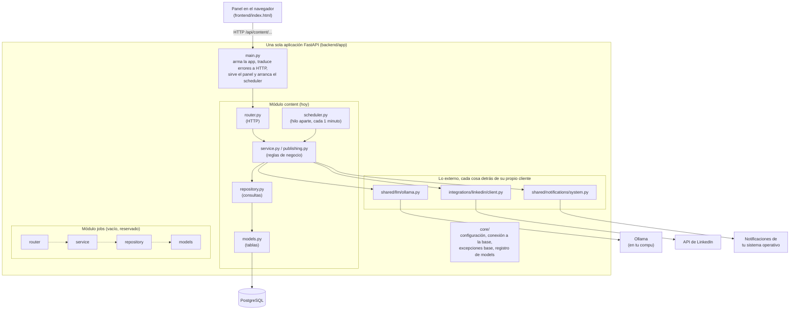
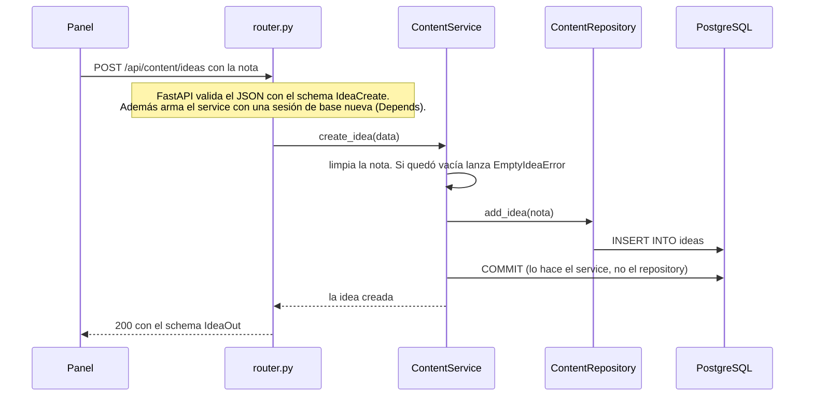
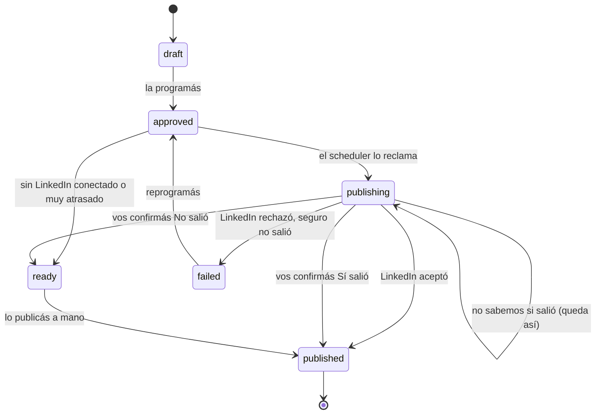
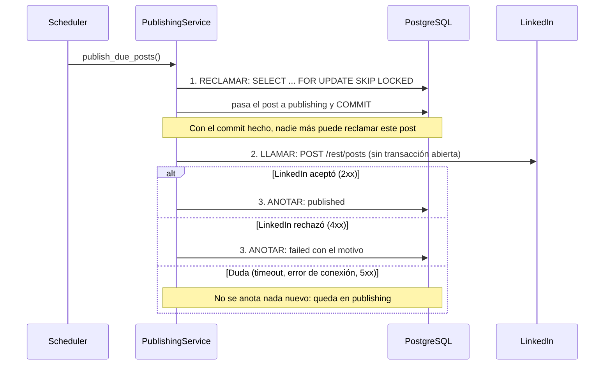

# Arquitectura de Postline

Este documento explica **cómo está armado el código y por qué**, pensado para alguien que está aprendiendo.
Si solo querés instalar y usar la app, andá al [README](README.md).

Postline es un **monolito modular en capas**. Suena grande, pero la idea es simple:

- **Monolito**: es *un solo programa* (un solo proceso de Python). No hay servicios sueltos hablándose por la red.
- **Modular**: el código está dividido en *módulos* (hoy `content`; mañana `jobs`) que no se meten en los asuntos del otro.
- **En capas**: dentro de cada módulo, cada archivo tiene *un solo trabajo* y solo puede hablar con el de abajo.

## Índice

1. [El mapa: módulos y capas](#1-el-mapa-módulos-y-capas)
2. [Qué hace cada capa (y qué tiene prohibido)](#2-qué-hace-cada-capa-y-qué-tiene-prohibido)
3. [Un pedido de punta a punta](#3-un-pedido-de-punta-a-punta)
4. [Por qué monolito modular y no microservicios](#4-por-qué-monolito-modular-y-no-microservicios)
5. [Cómo se evita publicar dos veces](#5-cómo-se-evita-publicar-dos-veces)
6. [Otras decisiones que conviene conocer](#6-otras-decisiones-que-conviene-conocer)
7. [Las reglas de trabajo (CLAUDE.md)](#7-las-reglas-de-trabajo-claudemd)
8. [Cómo sumar un módulo nuevo](#8-cómo-sumar-un-módulo-nuevo)
9. [Cómo se prueba](#9-cómo-se-prueba)

---

## 1. El mapa: módulos y capas

Cómo se lee: **cada flecha es "puede llamar a"**. Las capas de `content` van de arriba hacia abajo y nunca al revés:
el `router` llama al `service`, el `service` llama al `repository`, el `repository` usa los `models`.
`core/` es la base que usan todos (configuración, conexión a la base de datos).

El módulo `jobs` está dibujado con flechas punteadas porque **todavía no hace nada**: es un esqueleto con las mismas
capas, para que el día que se sume (postulaciones a empleos) ya tenga su lugar. Ver [su README](backend/app/modules/jobs/README.md).

### Dónde está cada cosa

| Carpeta | Qué hay |
|---|---|
| [backend/app/main.py](backend/app/main.py) | Punto de entrada: crea la app, registra los módulos, traduce errores a respuestas HTTP |
| [backend/app/core/](backend/app/core/) | Cosas de toda la app: [configuración](backend/app/core/config.py), [conexión a la base](backend/app/core/database.py), [excepciones base](backend/app/core/exceptions.py), [registro de models](backend/app/core/models_registry.py) |
| [backend/app/modules/content/](backend/app/modules/content/) | El módulo de contenido: ideas, posts, métricas, ajustes, publicación |
| [backend/app/modules/jobs/](backend/app/modules/jobs/) | Esqueleto vacío del futuro módulo de empleos |
| [backend/app/shared/](backend/app/shared/) | Piezas externas que pueden usar varios módulos: [Ollama](backend/app/shared/llm/ollama.py), [notificaciones](backend/app/shared/notifications/system.py) |
| [backend/app/integrations/](backend/app/integrations/) | Servicios de terceros: [LinkedIn](backend/app/integrations/linkedin/client.py) |
| [backend/migrations/](backend/migrations/) | Historial de cambios de la base de datos (Alembic) |
| [backend/tests/](backend/tests/) | Las pruebas |
| [frontend/index.html](frontend/index.html) | El panel: un solo archivo HTML con su CSS y su JavaScript, sin frameworks |

---

## 2. Qué hace cada capa (y qué tiene prohibido)

Pensalo como un restaurante: el **mozo** (router) toma el pedido y lo lleva; el **cocinero** (service) decide cómo
se prepara; el **despensero** (repository) es el único que entra a la despensa (la base de datos).
Si el mozo entrara a la despensa, o el despensero decidiera el menú, nadie sabría dónde arreglar nada.

| Capa | Su trabajo | Lo que NO puede hacer |
|---|---|---|
| **router** ([router.py](backend/app/modules/content/router.py)) | Recibir el pedido HTTP, validar el formato con un *schema*, llamar al service y devolver la respuesta | Tener lógica, tocar la base de datos, atrapar errores |
| **schemas** ([schemas.py](backend/app/modules/content/schemas.py)) | Definir la forma del JSON que entra y sale | Tener reglas de negocio |
| **service** ([service.py](backend/app/modules/content/service.py), [publishing.py](backend/app/modules/content/publishing.py)) | Las **reglas de negocio** y el control de la **transacción** (el `commit`) | Escribir consultas, conocer FastAPI (nada de `HTTPException`) |
| **repository** ([repository.py](backend/app/modules/content/repository.py)) | Las **consultas** a la base. Es el único que "habla SQL" | Hacer `commit`, decidir reglas de negocio |
| **models** ([models.py](backend/app/modules/content/models.py)) | Describir las tablas | Tener lógica |

Reglas que atraviesan todo:

- **Un módulo nunca importa los `models` ni el `repository` de otro módulo.** Si `jobs` necesita algo de `content`,
  se lo pide al *service* de `content`. Así cada módulo puede cambiar por dentro sin romper al otro.
- **Todo lo externo vive detrás de su propio cliente** en `shared/` o `integrations/` (Ollama, LinkedIn, notificaciones).
  El service no sabe *cómo* se habla con Ollama: solo conoce una interfaz (`PostWriter`). Por eso los tests pueden
  reemplazar a Ollama por un falso, y por eso cambiar de modelo o de proveedor toca un solo archivo.
- **Los errores se lanzan como excepciones de dominio** (`PostNotFoundError`, `InvalidInputError`...), sin pensar en HTTP.
  Un único lugar ([main.py](backend/app/main.py), `HTTP_STATUS_BY_ERROR`) decide qué código HTTP le toca a cada tipo:
  "no existe" → 404, "dato inválido" → 400, "falló algo externo" → 502.

> **Un matiz honesto:** el `service` recibe la *sesión* de la base de datos, pero solo la usa para `commit()` y
> `rollback()` (abrir y cerrar la transacción). Las consultas las hace siempre el `repository`. La transacción la
> maneja el service porque es quien sabe cuándo terminó una operación completa de negocio.

---

## 3. Un pedido de punta a punta

Ejemplo: en el panel escribís una idea y tocás **Guardar idea**. El panel manda `POST /api/content/ideas`.

Paso a paso, con los archivos:

1. **El navegador** llama a `POST /api/content/ideas` ([frontend/index.html](frontend/index.html), función `renderIdeas` y su botón).
2. **[main.py](backend/app/main.py)** ya registró el router de `content`, así que el pedido llega a
   `create_idea` en [router.py](backend/app/modules/content/router.py).
3. **FastAPI valida el cuerpo** con `IdeaCreate` ([schemas.py](backend/app/modules/content/schemas.py)). Si falta el campo `note`, responde 422 sin llegar al service.
4. **La inyección de dependencias** ([dependencies.py](backend/app/modules/content/dependencies.py)) le arma al router un `ContentService` con *una sesión de base de datos por pedido* (`get_session` en [database.py](backend/app/core/database.py), que además la cierra al terminar) y con el escritor de posts (Ollama). Los tests reemplazan esta pieza para meter falsos.
5. **El router llama** `service.create_idea(...)` y nada más. No hay un solo `if` de negocio ahí.
6. **El service** aplica la regla ("una idea vacía no se guarda"; si no, lanza `EmptyIdeaError`), le pide al repository que inserte y hace el `commit`.
7. **El repository** ejecuta el `INSERT` ([repository.py](backend/app/modules/content/repository.py)). No hace commit.
8. **La respuesta** vuelve como `IdeaOut` (el schema decide qué campos salen).

**Si algo falla** (por ejemplo la nota vacía): el service lanza `EmptyIdeaError` → como hereda de `InvalidInputError`,
el *exception handler* de [main.py](backend/app/main.py) lo convierte en `400 {"detail": "La idea está vacía."}`,
que es lo que el panel muestra en un aviso. El router no atrapó nada.

Los pedidos que esperan a Ollama (generar un borrador, planificar, sugerir ideas) tienen una regla extra: **el service
nunca espera al modelo con una transacción abierta**. Lee lo que necesita, hace `commit` (cierra la transacción), recién
entonces espera al modelo (puede tardar minutos) y después abre otra transacción para guardar. Una transacción abierta
mucho tiempo bloquea filas y ocupa conexiones.

---

## 4. Por qué monolito modular y no microservicios

Un **microservicio** es un programa chico e independiente que se comunica con otros por la red. Sirven cuando hay
equipos grandes que necesitan desplegar por separado o partes que escalan distinto. Tienen un costo enorme:
redes que fallan, versiones que hay que coordinar, más cosas que instalar y vigilar.

Postline es **una app para una sola persona que corre en su propia compu**. Para eso:

- Un solo proceso es **mucho más simple de instalar y de depurar** (un comando, un log).
- Una llamada entre módulos es una llamada a una función: no falla "por la red" ni hay que serializar nada.
- Una transacción de base de datos puede abarcar varias cosas a la vez; entre servicios habría que coordinarlas.

Aun así no queremos un "plato de espagueti". Por eso es **modular**: los módulos tienen fronteras claras
(no se importan los models ni repositories ajenos), así que si algún día una parte creciera o tuviera que salir
a su propio programa, ya está separada por una línea limpia. *Modular* te da la mayor parte del orden de los
microservicios sin su costo.

Por la misma razón no hay colas de mensajes (Celery, Redis...): el scheduler es un hilo de [APScheduler](https://apscheduler.readthedocs.io/)
dentro del mismo proceso que corre una vez por minuto, que alcanza de sobra para 2 o 3 posts por semana.

---

## 5. Cómo se evita publicar dos veces

Publicar dos veces el mismo post en LinkedIn es el peor error posible: es público y no se puede deshacer desde la app.
Por eso es la parte más cuidada del sistema ([publishing.py](backend/app/modules/content/publishing.py)).

El enemigo es una **duda**: el scheduler le dice a LinkedIn "publicá esto", se corta la conexión, y no sabemos si
LinkedIn lo publicó o no. Si reintentáramos a ciegas, podríamos duplicarlo.

### Los estados de un post

### Los tres pasos, cada uno en su propia transacción

1. **Reclamar.** Se busca el próximo post vencido con `SELECT ... FOR UPDATE SKIP LOCKED`: bloquea la fila para que
   *si otro proceso intenta lo mismo a la vez, se la saltee en vez de esperar* (así, dos procesos nunca agarran el
   mismo post). Se lo pasa a `publishing` y se hace `COMMIT`.
2. **Llamar a LinkedIn.** Recién con el estado ya guardado se hace la llamada HTTP, **sin ninguna transacción abierta**.
3. **Anotar el resultado**, en otra transacción, solo si el post sigue en `publishing`.

### Errores seguros vs. errores dudosos

| Qué pasó | ¿Sabemos si salió? | Qué hace la app |
|---|---|---|
| LinkedIn contesta 2xx | **Sí, salió** | `published` |
| LinkedIn contesta 4xx (por ejemplo 401 permiso vencido, 422 texto inválido, 429 demasiados pedidos) | **Sí, NO salió** (el pedido fue rechazado) | `failed`, con el motivo en claro. Podés reintentar |
| Se corta la conexión, pasa el tiempo máximo, LinkedIn responde 5xx, 408 o 409 | **No sabemos** | **Queda en `publishing`** con el aviso "verificá en LinkedIn". **Nunca se reintenta solo** |
| La app se cae justo entre el paso 2 y el 3 | **No sabemos** | Igual: queda en `publishing` |

Dos detalles más:

- Un post en `publishing` **nunca vuelve solo a `approved`**, así que el scheduler no lo vuelve a tocar. La persona
  lo resuelve a mano: mira su perfil de LinkedIn y toca **"Sí, salió"** (pasa a `published`, con el link opcional) o
  **"No salió"** (pasa a `ready`).
- Si LinkedIn rechaza con *"Content is a duplicate of urn:li:share:N"*, la app interpreta que el post **ya estaba
  publicado**, lo marca `published` con ese identificador y no vuelve a publicar.

El botón **Publicar ahora** usa exactamente el mismo camino de reclamo que el scheduler. Y los tests simulan el
caso más peligroso: la app muerta justo entre el paso 2 y el 3 ([test_publishing.py](backend/tests/db/test_publishing.py)).

---

## 6. Otras decisiones que conviene conocer

- **Fechas.** En la base se guardan como `timestamptz` (con zona horaria, en UTC). La zona del usuario sale de
  `TIMEZONE` en el `.env`. El panel y la API intercambian fechas *locales* tipo `"2026-11-10T09:00"`;
  [timeutil.py](backend/app/core/timeutil.py) hace la conversión en un solo lugar.
- **Dos lugares para la configuración.** El `.env` guarda lo que cambia de una instalación a otra y los secretos
  (URL de la base, credenciales de LinkedIn). La tabla `settings` guarda lo que la persona edita desde el panel
  (días, hora, modelo, interruptor de notificaciones) y también el permiso de LinkedIn. Esa tabla *nunca* devuelve los
  tokens por la API.
- **El estado como texto con restricción.** `posts.status` es un `VARCHAR` con un `CHECK` en la base, más un `Enum`
  de Python. Agregar un estado es una migración chica (ver [la del estado `publishing`](backend/migrations/versions/)).
  Ojo: *Alembic no compara los `CHECK` al autogenerar*, así que esas migraciones se escriben a mano.
- **Migraciones con Alembic.** Cada cambio de la base es un archivo en [migrations/versions/](backend/migrations/versions/),
  con `upgrade` y `downgrade`. Se aplican con `alembic upgrade head`.
- **Notificaciones del sistema.** Cuando el scheduler deja un post en "Publicar a mano" avisa con una notificación
  del sistema operativo. El texto del post **nunca se pega dentro de un script**: viaja por variables de entorno del
  proceso hijo y se lanza con una lista de argumentos, sin shell. Si no, un post con `$(...)` podría ejecutar comandos
  (inyección de comandos). Está probado con textos hostiles ([test_system_notifier.py](backend/tests/unit/test_system_notifier.py)).
  Si el aviso falla, se registra un aviso en el log y todo sigue.
- **El scheduler corre en otro hilo.** No comparte la sesión de base de datos con los pedidos HTTP: cada pasada
  abre y cierra la suya. Nunca lanza una excepción hacia afuera: si algo falla se registra y reintenta al minuto.

---

## 7. Las reglas de trabajo (CLAUDE.md)

El archivo [CLAUDE.md](CLAUDE.md) tiene reglas de cómo se trabaja en este proyecto con un asistente de programación
(Claude Code). Están pensadas para que nada importante pase en silencio:

1. **"Mostrame antes" significa parar.** Si el pedido dice "mostrame antes" o "explicame antes", no se ejecuta ni se
   aplica nada hasta que la persona responda. Vale en especial para migraciones, cambios de configuración y todo
   lo difícil de deshacer.
2. **Editar archivos con la herramienta de edición**, no con scripts que reemplazan texto: si el texto buscado no
   coincide, esos scripts fallan en silencio y el cambio no se aplica sin que nadie lo note.
3. **No tocar el `.env`** de la persona. Si hace falta una variable nueva, se agrega a `.env.example` y se le avisa
   qué líneas copiar. El `.env` tiene sus secretos.
4. **Windows: acentos y consola.** En Windows los acentos pueden romper `grep` y la salida de la consola, y la salida
   se ve cortada sin ningún error. No se filtra con `grep`/`head`/`sed` lo que se le muestra a la persona para que
   revise; se fuerza UTF-8 y se lee desde un archivo; y nunca se da por bueno un resultado que se ve raro.

---

## 8. Cómo sumar un módulo nuevo

Ejemplo: el módulo `jobs` (postulaciones a empleos). Ya existe como esqueleto en
[backend/app/modules/jobs/](backend/app/modules/jobs/); para uno completamente nuevo (`foo`) los pasos son los mismos.

1. **Carpeta del módulo** `backend/app/modules/foo/` con las mismas capas que `content`:
   `models.py`, `repository.py`, `service.py`, `schemas.py`, `router.py`, `exceptions.py`, `dependencies.py`.
2. **Models.** Heredá de `Base` ([database.py](backend/app/core/database.py)); `TimestampMixin` te da `created_at` y `updated_at`.
3. **Registrar los models** en [core/models_registry.py](backend/app/core/models_registry.py):
   `from app.modules.foo import models as foo_models  # noqa: F401`. Es imprescindible: Alembic solo conoce las tablas
   cuyos models *ya fueron importados*. Sin esta línea, `alembic revision --autogenerate` vería una base vacía.
4. **Migración.** Desde `backend/`: `alembic revision --autogenerate -m "tablas de foo"`. **Revisá el archivo generado
   a mano** antes de aplicarlo (recordá que no detecta `CHECK`), y probá `upgrade` y `downgrade`.
5. **Excepciones.** En `foo/exceptions.py` hacelas heredar de las bases de [core/exceptions.py](backend/app/core/exceptions.py)
   (`NotFoundError`, `InvalidInputError`, `ExternalServiceError`). **No hace falta registrar nada nuevo**: el *exception
   handler* de [main.py](backend/app/main.py) usa `isinstance`, así que ya sabe qué código HTTP devolver.
   Solo si necesitás un tipo de error nuevo con un código distinto, sumás una fila a `HTTP_STATUS_BY_ERROR`.
6. **Router.** Con prefijo propio (`/api/foo`), y registralo en `create_app()` de [main.py](backend/app/main.py):
   `app.include_router(foo_router)`.
7. **Dependencias.** En `foo/dependencies.py` armá el service que usa el router. Lo externo (otro servicio, otro
   modelo de lenguaje) va detrás de un cliente en `shared/` o `integrations/`.
   Si necesita algo de `content`, **pedíselo al service de `content`**, nunca a su repository ni a sus models.
8. **Menú lateral.** En [frontend/index.html](frontend/index.html), copiá el bloque `
` del menú con el
   título del módulo (por ejemplo "Empleos") y sus enlaces `href="#vista"`; agregá una `<section id="v-vista">` por
   cada vista y registrala en el objeto `VIEWS` del JavaScript. El `API` base de ese módulo será `/api/foo`.
9. **Tareas periódicas** (si hacen falta): un `add_job` más en el scheduler, con sesión propia.
10. **Tests** de cada capa (ver abajo) y, si tocaste el panel, un chequeo estático en
    [test_frontend.py](backend/tests/unit/test_frontend.py) que verifique que las rutas que llama existen.

---

## 9. Cómo se prueba

Las pruebas viven en [backend/tests/](backend/tests/) y se corren con `pytest` desde `backend/` (hace falta Postgres
levantado: `docker compose up -d`). Hay tres tipos:

| Tipo | Carpeta | Qué prueba | Cómo |
|---|---|---|---|
| **Unitarias** | `tests/unit/` | Funciones puras: reglas de texto, prompts, fechas, cliente de Ollama y de LinkedIn | Sin base de datos. Los clientes HTTP usan un *transporte simulado* (`httpx.MockTransport`) |
| **De service** | `tests/db/` | La lógica de negocio contra Postgres real: publicar sin duplicar, planificar, notificar | Con *fakes* en lugar de Ollama y LinkedIn |
| **De API** | `tests/api/` | La app completa a través de HTTP | `TestClient` de FastAPI |

Las pruebas **nunca tocan tu base de desarrollo**: usan otra base (`<nombre>_test`) en el mismo contenedor, que
crean solas y migran antes de empezar. Cada test arranca con las tablas vacías. Además hay un *timeout* de 60 segundos
por test, para que uno colgado falle con un mensaje en vez de dejar todo trabado.
