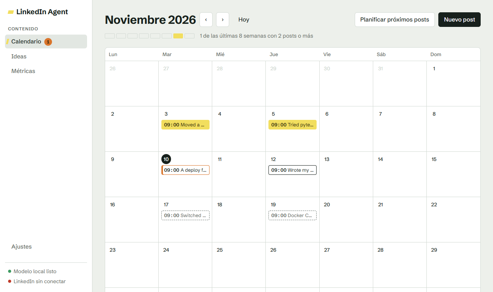
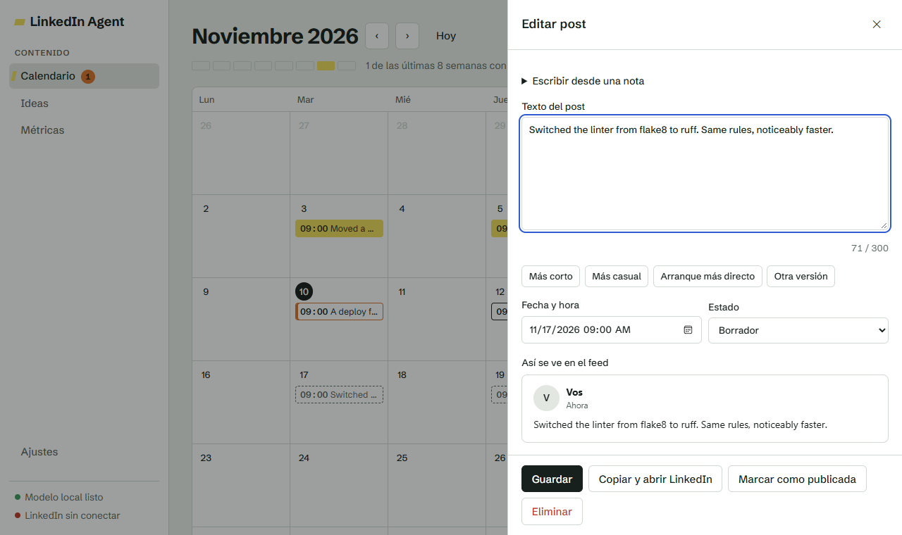
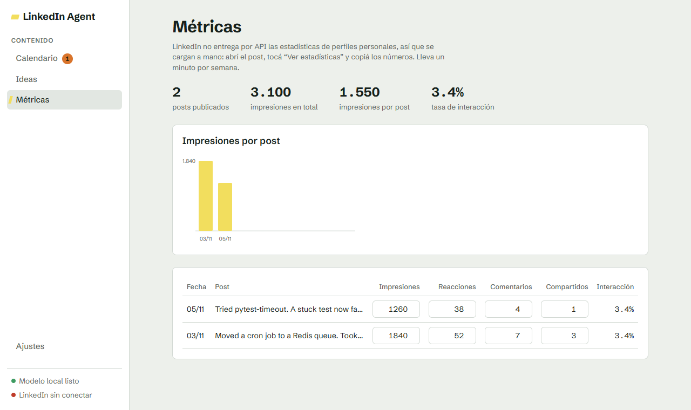
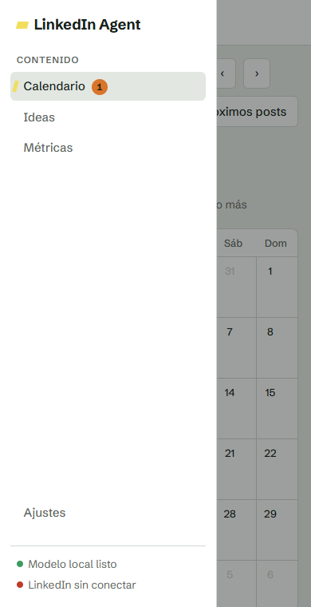
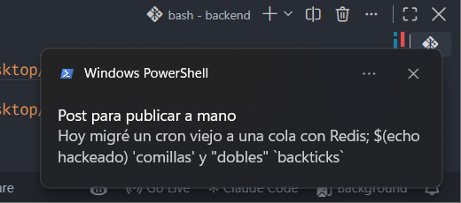

# LinkedIn Agent

Planificador de posts de LinkedIn que corre **en tu propia compu**. Anotás ideas, un modelo de lenguaje local
([Ollama](https://ollama.com)) arma borradores cortos en inglés, los revisás en un calendario y los publicás
(a mano, o solos si conectás tu cuenta). Pensado para sostener un ritmo de 2 o 3 posts por semana sin pinta de IA.



## Qué es y para quién

- **Cada persona corre su propia copia.** No es un servicio en la nube ni hay cuentas: **no hay login ni usuarios**.
  Tus ideas, posts y métricas viven en una base de datos local (PostgreSQL en Docker). Nada sale de tu compu salvo
  lo que vos mandás a LinkedIn.
- Sirve para una sola persona por instalación. Si dos personas quieren usarla, cada una la instala en su compu.
- El texto lo escribe un modelo que corre en tu máquina (no hay claves de ninguna API de IA).
- Conectar LinkedIn es **opcional**: sin conectarlo la app funciona igual, y cuando un post llega a su hora te avisa
  para que lo publiques a mano.

Cómo está hecho por dentro (capas, módulos, cómo se evita publicar dos veces): [ARCHITECTURE.md](ARCHITECTURE.md).

## Qué hace

- **Ideas**: anotás en castellano y desprolijo cosas concretas de tu semana. Son la materia prima. El botón
  **Sugerir ideas** te hace preguntas sobre lo que ya anotaste para ayudarte a recordar más detalles reales.
- **Planificar próximos posts**: toma las ideas sin usar y arma borradores en inglés en tus próximos días de publicación.
- **Calendario**: ves todo por fecha. Cada post pasa por *Borrador → Programada → Publicada*. Solo lo que marcás como
  *Programada* sale solo; nada se publica sin que lo hayas aprobado.
- **Editor**: contador de caracteres, aviso de frases que suenan a IA, botones "Más corto", "Más casual", y una vista
  previa que marca dónde LinkedIn corta con "…ver más".
- **Notificación del sistema** cuando un post queda listo para publicar a mano, y un número en el menú con cuántos esperan.
- **Métricas**: cargás a mano impresiones, reacciones, comentarios y compartidos de cada post y ves totales y tasa de interacción.

| Editor | Métricas | Menú en pantalla chica |
|---|---|---|
|  |  |  |

## Requisitos

| Qué | Para qué | Dónde conseguirlo |
|---|---|---|
| **Python 3.12 o más nuevo** | Correr la app | [python.org/downloads](https://www.python.org/downloads/). En Windows, tildá *Add python.exe to PATH* al instalar |
| **Docker** (con `docker compose`) | La base de datos PostgreSQL | Windows y macOS: [Docker Desktop](https://www.docker.com/products/docker-desktop/). Linux: [Docker Engine](https://docs.docker.com/engine/install/) con el plugin Compose |
| **Ollama** | El modelo de lenguaje local | [ollama.com/download](https://ollama.com/download) |
| **Git** | Bajar el código | [git-scm.com](https://git-scm.com/) |
| Unos **8 GB de RAM libres** | El modelo `llama3.1:8b` (4,9 GB de descarga) | Con menos memoria probá un modelo más chico (por ejemplo uno de 3B) y cambialo en Ajustes |

> Se probó en **Windows 11** (Git Bash, PowerShell, Docker Desktop, Ollama). Los pasos para **macOS y Linux** son los
> equivalentes habituales, pero **no se probaron** en esas máquinas.

## Instalación

Todos los comandos se corren desde la carpeta del proyecto, salvo donde diga lo contrario.

### 1. Bajar el código y crear tu archivo `.env`

```bash
git clone https://github.com/francooyhenart/linkedin-agent.git
cd linkedin-agent
```

Copiá el archivo de ejemplo. El `.env` es **tuyo y no se sube a git**: ahí van tus claves.

| Sistema | Comando |
|---|---|
| macOS, Linux, Git Bash | `cp .env.example .env` |
| Windows (cmd) | `copy .env.example .env` |
| Windows (PowerShell) | `Copy-Item .env.example .env` |

Con los valores por defecto ya funciona. Solo mirá `TIMEZONE` y poné la tuya
([lista de zonas](https://en.wikipedia.org/wiki/List_of_tz_database_time_zones)).

### 2. Levantar la base de datos

Abrí Docker Desktop (en Windows y macOS) y corré:

```bash
docker compose up -d
docker compose ps        # esperá a que diga "healthy"
```

Si el puerto 5432 ya lo usa otro Postgres, poné `POSTGRES_PORT=5433` en tu `.env` y cambiá también el puerto en `DATABASE_URL`.
Si ya tenés **otra copia de LinkedIn Agent** corriendo en la misma compu, además definí un nombre distinto para el contenedor
antes de levantarlo (`export COMPOSE_PROJECT_NAME=linkedin-agent2` en bash, `$env:COMPOSE_PROJECT_NAME="linkedin-agent2"` en PowerShell).

### 3. Instalar Python y las dependencias

Creá un entorno virtual (una carpeta `.venv` con las librerías de este proyecto, aparte del resto de tu compu) y activalo:

| Sistema | Crear | Activar |
|---|---|---|
| macOS, Linux | `python3 -m venv .venv` | `source .venv/bin/activate` |
| Windows, Git Bash | `python -m venv .venv` | `source .venv/Scripts/activate` |
| Windows, PowerShell | `python -m venv .venv` | `.venv\Scripts\Activate.ps1` |
| Windows, cmd | `python -m venv .venv` | `.venv\Scripts\activate.bat` |

Con el entorno activado (se ve `(.venv)` en la terminal):

```bash
cd backend
pip install -r requirements.lock
pip install -e . --no-deps
```

### 4. Crear las tablas

```bash
alembic upgrade head
```

Esto crea las tablas en la base. Repetilo cada vez que actualices el código (`git pull`): si no hay nada nuevo, no hace nada.

### 5. Instalar el modelo de lenguaje

Instalá Ollama (Windows y macOS: el instalador de [ollama.com/download](https://ollama.com/download); Linux:
`curl -fsSL https://ollama.com/install.sh | sh`) y bajá el modelo:

```bash
ollama pull llama3.1:8b
ollama list             # tiene que aparecer llama3.1:8b
```

Si en **Git Bash** te dice `ollama: command not found`, mirá [Problemas conocidos en Windows](#problemas-conocidos-en-windows).

### 6. Arrancar

Desde `backend/`, con el entorno activado:

```bash
python -m app
```

Abrí **<http://127.0.0.1:8000>**. Para comprobar que todo está conectado mirá <http://127.0.0.1:8000/health>:
tiene que decir `{"status":"ok","database":true}`. Abajo a la izquierda del panel, los puntos verdes indican que
el modelo local responde.

## Levantar y apagar todo

**Cada vez que quieras usarla**, en este orden:

1. Docker en marcha (abrí Docker Desktop) y la base: `docker compose up -d`.
2. Ollama en marcha. En Windows y macOS es la app (queda en la bandeja del sistema). En Linux, el servicio, o `ollama serve`.
3. La app: desde `backend/` con el entorno activado, `python -m app`.

**Para apagar:**

| Qué | Cómo | Qué pasa con tus datos |
|---|---|---|
| La app | `Ctrl+C` en la terminal donde corre | Nada, siguen en la base |
| La base | `docker compose stop` | Siguen en el volumen |
| La base (quitar el contenedor) | `docker compose down` | **Siguen** en el volumen |
| La base y **borrar todo** | `docker compose down -v` | ⚠️ **Se borran** todas tus ideas, posts y métricas |

> **La app tiene que estar corriendo a la hora del post**: el que publica y avisa es el programa, no LinkedIn.

## Uso diario

1. **Ideas.** Entrá a *Ideas* y anotá cosas concretas que te pasaron (qué herramienta, cuánto tardaste, qué salió mal).
   Con 3 o 4 ya podés planificar. Si no se te ocurre qué anotar, **Sugerir ideas** te hace preguntas sobre lo que ya
   cargaste; tocás una, la respondés con tus palabras y recién ahí se guarda (junto con la pregunta, para que tenga contexto).
2. **Planificar.** **Planificar próximos posts** arma un borrador por idea en tus próximos días de publicación.
   Tarda unos segundos por borrador (con `llama3.1:8b` en una CPU normal, del orden de 20 segundos cada uno).
3. **Revisar.** En el *Calendario* tocá un borrador para abrir el editor. Corregilo, usá los botones de ajuste
   y mirá la vista previa. El texto lo escribe un modelo: **leelo siempre**.
4. **Programar.** En el editor cambiá el estado a **Programada (sale sola)** y elegí fecha y hora.
5. **Publicar a mano.** Si no conectaste LinkedIn (o el post se atrasó), a la hora del post pasa a **Publicar a mano**,
   te llega una notificación y el menú muestra un número junto a *Calendario*. Abrí el post, tocá **Copiar y abrir
   LinkedIn**, pegá, publicá y volvé a tocar **Marcar como publicada** (podés pegar el link del post).
   Si conectaste LinkedIn, sale solo y esto no hace falta.
6. **Métricas.** Cada tanto abrí tu post en LinkedIn, mirá las estadísticas y cargá los números en *Métricas*.
   Lleva un minuto por semana.

En **Ajustes** elegís los días y la hora de publicación, el máximo de caracteres, el modelo de Ollama y pegás 2 o 3
posts tuyos de ejemplo (es lo que más ayuda a que suene a vos).

### Notificaciones

Cuando el scheduler deja un post en **Publicar a mano** muestra una notificación del sistema con el comienzo del texto
(si caen varios en el mismo minuto, una sola: "3 posts para publicar a mano"). Funciona aunque el navegador esté
cerrado, mientras la app esté corriendo. Se apaga en *Ajustes → Avisarme cuando un post quede para publicar a mano*.



*Captura real. El texto de prueba tiene comillas, `$(...)` y backticks a propósito: se muestra tal cual y no se ejecuta nada.*

- **Windows**: probado. Aparece como "Windows PowerShell" y al tocarla abre el panel. Si tenés activado "No molestar" o el
  Asistente de concentración, no se ve el cartel pero queda en el Centro de notificaciones.
- **macOS** y **Linux**: no probado. En macOS usa `osascript` (puede pedirte permiso en *Ajustes del Sistema → Notificaciones*);
  en Linux usa `notify-send` (paquete `libnotify-bin` o `libnotify`) y un servidor de notificaciones del escritorio.
  Si falta algo, la app lo anota en el log y sigue funcionando; el número del menú y el título de la pestaña
  (`(1) LinkedIn Agent`) siguen avisando dentro del panel.

## ¿`pyproject.toml` o `requirements.lock`?

Las dos viven en `backend/` y sirven para cosas distintas:

- **`pyproject.toml`** dice qué necesita el proyecto, con rangos (`sqlalchemy>=2.1,<3`: cualquier 2.x desde la 2.1).
  Es lo que editás cuando agregás una dependencia.
- **`requirements.lock`** es el resultado de `pip freeze`: las **versiones exactas**, con todas las dependencias
  indirectas, con las que se probó la app.

**Para usar la app, instalá desde el lock** (es lo que se probó, y el resultado es el mismo para todos):

```bash
pip install -r requirements.lock
pip install -e . --no-deps
```

**Para desarrollar** (agregar o actualizar paquetes), instalá desde `pyproject.toml` y regenerá el lock:

```bash
pip install -e ".[dev]"
pip freeze --exclude-editable > requirements.lock
```

El lock incluye las herramientas de desarrollo (pytest) y se generó en **Windows con Python 3.12**. Si en macOS o Linux
`pip install -r requirements.lock` falla con algún paquete, usá `pip install -e .` (instala versiones compatibles según `pyproject.toml`).

## Conectar LinkedIn (opcional)

> **Importante:** estos pasos salen de la documentación de LinkedIn y **no se probaron con una cuenta real**. LinkedIn
> cambia sus pantallas seguido: si algún nombre no coincide, buscá el equivalente.

Sin conectar nada la app funciona (publicás a mano). Conectarla sirve para que los posts programados salgan solos.
Usa la API oficial de LinkedIn (no scraping, que es lo que hace que suspendan cuentas) y **solo para publicar**: no se
usa para iniciar sesión en la app.

1. **Creá una app de desarrollador.** Entrá a <https://www.linkedin.com/developers/apps> con tu cuenta y tocá *Create app*.
   Te pide: un nombre (el que quieras), una **página de LinkedIn** a la que asociarla y un logo.
   LinkedIn exige asociar la app a una *página de empresa*: si no tenés, creá una simple desde *Crear una página de
   empresa* (no hace falta que sea una empresa real; alcanza con una página mínima).
2. **Verificá la página.** En la app, pestaña *Settings*, tocá *Verify* junto a la página, generá el link de
   verificación y abrilo con una cuenta que administre esa página.
3. **Pedí los productos.** En la pestaña *Products* solicitá estos dos (son de acceso inmediato, sin revisión):
   - **Share on LinkedIn** (permite publicar en tu nombre).
   - **Sign In with LinkedIn using OpenID Connect** (permite saber quién sos).
4. **Autorizá la dirección de vuelta.** En la pestaña *Auth*, en *OAuth 2.0 settings → Authorized redirect URLs for your app*,
   agregá exactamente: `http://localhost:8000/auth/linkedin/callback`. **Tiene que coincidir letra por letra** con
   `LINKEDIN_REDIRECT_URI` de tu `.env` (si cambiaste el puerto, cambialo en los dos lados).
5. **Copiá las credenciales.** En la misma pestaña *Auth* están el **Client ID** y el **Primary Client Secret**.
   Pegalos en tu `.env`:
   ```
   LINKEDIN_CLIENT_ID=...
   LINKEDIN_CLIENT_SECRET=...
   ```
   El *Client Secret* es una contraseña: no lo compartas ni lo subas a ningún lado.
6. **Reiniciá la app** (`Ctrl+C` y `python -m app`) para que lea el `.env`.
7. **Conectá.** En el panel andá a *Ajustes → LinkedIn* y tocá **Conectar LinkedIn**. Se abre LinkedIn: aceptá el permiso y volvés al panel.

LinkedIn da el permiso por **60 días** y no se renueva solo: el panel avisa cuando falta poco (el menú muestra un punto rojo
en pantallas chicas) y tenés que tocar *Renovar conexión*.

La app le dice a LinkedIn qué versión de su API usa con `LINKEDIN_API_VERSION` (formato `AAAAMM`, hoy `202610`).
LinkedIn da de baja cada versión **al año**: el panel avisa cuando tiene más de 10 meses. Para actualizarla, mirá las versiones
vigentes en la [documentación de LinkedIn](https://learn.microsoft.com/en-us/linkedin/marketing/versioning), cambiá el valor
en tu `.env` y reiniciá.

## Problemas conocidos en Windows

- **`localhost` se cuelga o no conecta (IPv6).** En Windows `localhost` puede resolverse primero a `::1` (IPv6) y
  Docker/Ollama solo escuchan en IPv4. Por eso el `.env.example` usa **`127.0.0.1`** para la base y para Ollama, y
  conviene abrir el panel en `http://127.0.0.1:8000`. No lo cambies a `localhost`. (La dirección de vuelta de LinkedIn sí
  usa `localhost` porque la abre el navegador, que sabe probar las dos.)
- **`ollama: command not found` en Git Bash.** El instalador de Ollama lo agrega al PATH de Windows, pero una terminal que
  ya estaba abierta no se entera, y Git Bash a veces no lo toma. Primero cerrá y volvé a abrir la terminal. Si sigue igual,
  agregalo a Git Bash una vez:
  ```bash
  echo 'export PATH="$PATH:$(cygpath "$LOCALAPPDATA")/Programs/Ollama"' >> ~/.bashrc
  ```
  Abrí una terminal nueva y probá `ollama --version`. (PowerShell y cmd suelen encontrarlo sin esto.)
- **Los acentos se ven rotos en la consola** (`ó` en vez de `ó`). Es solo cómo la consola de Windows muestra el UTF-8:
  los archivos están bien. Para verlos bien: `export PYTHONUTF8=1` (Git Bash) o `$env:PYTHONUTF8=1` (PowerShell), o redirigí
  la salida a un archivo y abrilo en tu editor.
- **`python` abre la Microsoft Store.** Windows trae un atajo falso. Instalá Python desde python.org (tildando *Add to PATH*)
  o usá `py -3.12` en lugar de `python`.
- **PowerShell no deja activar el entorno** ("la ejecución de scripts está deshabilitada"). Una sola vez:
  `Set-ExecutionPolicy -Scope CurrentUser RemoteSigned`.
- **`error during connect` / `docker compose` no responde.** Docker Desktop no está abierto: abrilo y esperá a que arranque.
- **El puerto 8000 o 5432 está ocupado.** Cambiá `PORT` o `POSTGRES_PORT` en tu `.env` (y el puerto de `DATABASE_URL`).
- **Git avisa `LF will be replaced by CRLF`.** Es inocuo.

## Limitaciones conocidas

- **Las métricas se cargan a mano.** LinkedIn no entrega por API las estadísticas de perfiles personales.
- **Los hashtags salen como texto, sin link.** La API de publicación de LinkedIn trata varios caracteres (`#`, `@`, `_`,
  `*`, paréntesis, corchetes...) como marcado, así que la app los escapa para que el post salga *exactamente* como lo
  escribiste. El efecto: `#devops` se ve como texto común, no es clickeable, y no se pueden hacer menciones. La app, de
  todos modos, evita los hashtags al generar borradores.
- **La app tiene que estar corriendo a la hora del post.** Si la compu estuvo apagada, al prender publica lo atrasado
  hasta 12 horas (`MAX_LATE_HOURS`); lo más viejo queda como "Publicar a mano" para que no salgan varios posts juntos.
- **Las preguntas de "Sugerir ideas" pueden salir con errores de gramática** (tuteo en vez de voseo, verbos mal
  conjugados) y, a veces, preguntan por algo que no viviste. Con `llama3.1:8b` pasa; son solo sugerencias, nada se guarda
  hasta que vos escribís tu respuesta.
- **Un post puede quedar en "Verificar en LinkedIn".** Si LinkedIn no contesta a tiempo o responde con un error del
  servidor, la app no puede saber si el post salió: lo deja en ese estado y **nunca lo reintenta sola**, para no
  publicarlo dos veces. Mirá tu perfil: si salió tocá "Sí, salió"; si no, "No salió".
- **La versión de la API de LinkedIn vence cada año** (ver arriba).
- **Los borradores salen en inglés** y la calidad depende del modelo: siempre se revisan antes de publicar.
- **Las notificaciones del sistema solo se probaron en Windows.**

## Seguridad

- **La app solo escucha en `127.0.0.1`** (tu propia máquina) y **no tiene login**: cualquiera que llegue a su dirección
  puede ver y borrar tus posts, y publicar en tu LinkedIn si lo conectaste.
- **Nunca la expongas a la red**: no cambies `HOST` a `0.0.0.0`, no abras el puerto en el router, no uses túneles
  (ngrok, Cloudflare Tunnel...) ni la publiques en un servidor.
- La base de datos también queda publicada solo en `127.0.0.1`. Su usuario y contraseña por defecto (`linkedin`) no
  son secretos porque no se puede llegar desde afuera; si compartís la compu con otras personas, cambialos en el `.env`.
- El permiso de LinkedIn se guarda **sin cifrar** en la tabla `settings` de tu base local. Quien tenga acceso a tu
  compu o a esa base puede leerlo. Si lo perdés de vista, podés revocarlo desde la configuración de tu cuenta de LinkedIn (la sección de privacidad
  que lista los servicios con permiso; el nombre exacto cambia) o borrando la app en el portal de desarrolladores.
- El `.env` tiene tus claves y está en `.gitignore`: no lo subas a ningún repositorio.

## Para quien quiera tocar el código

```bash
cd backend
pip install -e ".[dev]"
pytest                 # necesita la base levantada; usa una base aparte "<nombre>_test"; tarda de 1 a 3 minutos
alembic check          # compara los modelos con la base (tiene que decir "No new upgrade operations detected")
```

- Cómo está organizado y cómo sumar un módulo: [ARCHITECTURE.md](ARCHITECTURE.md).
- Reglas de trabajo con asistentes de programación: [CLAUDE.md](CLAUDE.md).
- El módulo [`jobs`](backend/app/modules/jobs/README.md) está reservado para una futura sección de postulaciones a empleos.
